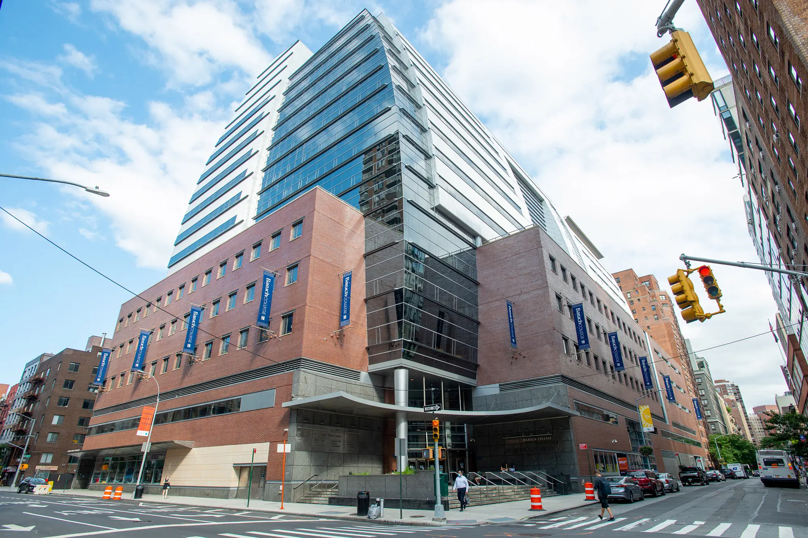
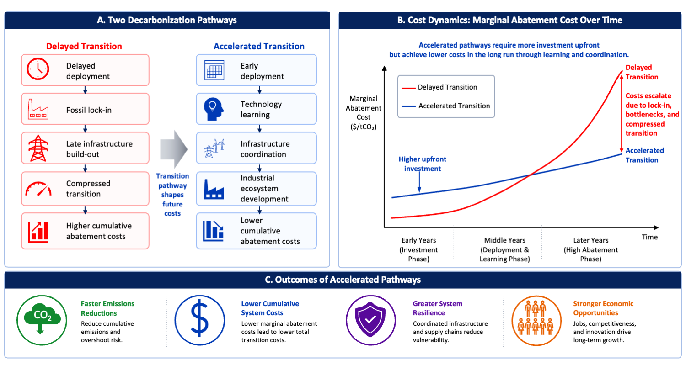
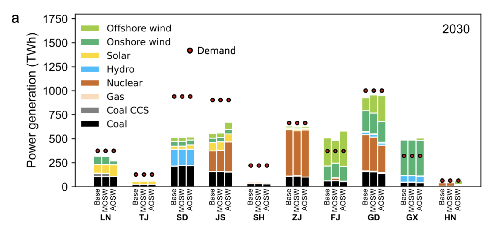
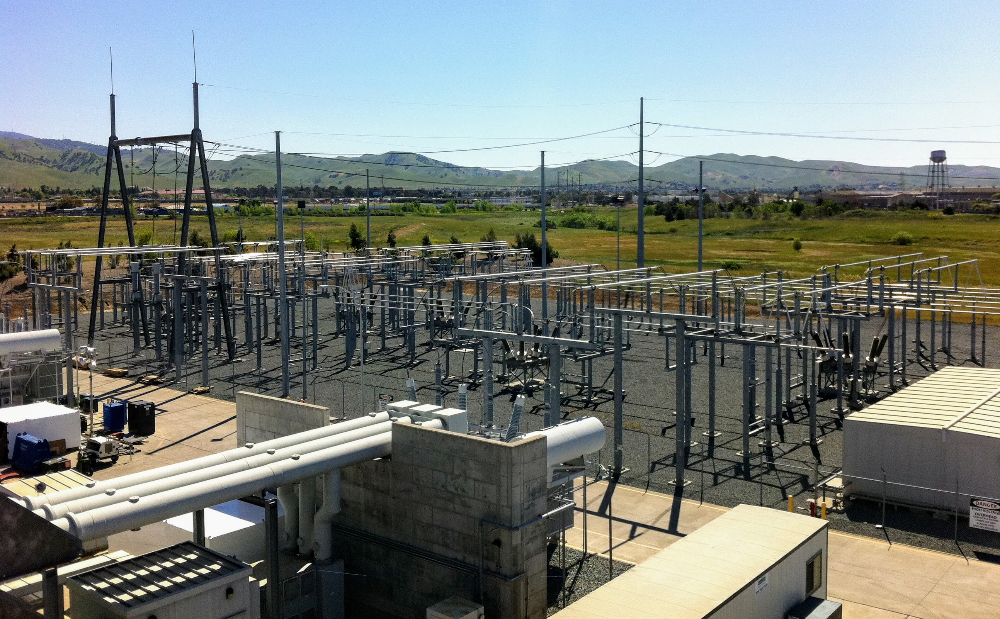
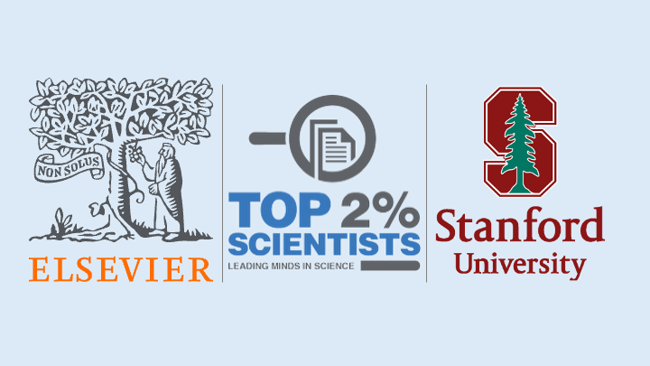
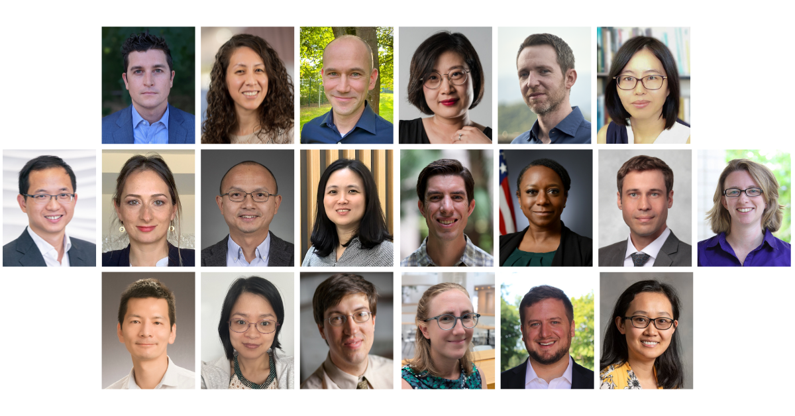

# Gang He

Associate Professor  
Marxe School of Public and International Affairs  
Baruch College  
City University of New York  
Email: gang.he@baruch.cuny.edu

Gang He

Associate Professor of Energy and Climate Policy  
Marxe School of Public and International Affairs  
Baruch College and Graduate Center  
City University of New York  
Email: gang.he@baruch.cuny.edu

[Bio](bio.llms.md)

[CV](cv.llms.md)

         
   

Impactful Research on Clean Energy Transitions, Climate Policy, and Sustainable Development

7,500+

Google Scholar Citations

h-index: 37 · September 2026

DEEP

Founder & Director

Energy and Climate Policy Lab

Top 2%

World’s Scientists

Three consecutive years

Global Reach

Research Informing Policy

IPCC · World Bank · UN · WTO

Featured Research Findings

Climate and Public Health

595 Avoided Deaths

### Imported Solar Panels Deliver Major Benefits

Imported solar PVs contributed to 178 million tonnes of avoided CO₂ emissions and 595 avoided premature deaths in the United States, generating an estimated \$28 billion in climate and health benefits.

*One Earth* · 2025

Clean Energy Supply Chains

\$67 Billion

### Global Solar Supply Chains Reduce Costs

Globalized supply chains have saved solar installers in the U.S., Germany, and China \$67 billion from 2008–2020. Solar prices could be 20–30% higher in 2030 if countries move toward domestic-only production.

*Nature* · 2022

Accelerating Energy Transitions

11% Cheaper

### Renewable Pathways are Cost-Effective

Rapid cost reductions in renewable energy and storage technologies reshaped the energy transition landscape, showing that a renewable-dominant pathway is both technologically sound and cost-effective.

*Nature Communications* · 2020

Recent Posts

##### Serving as Provost Faculty Fellow for Grant Development

Oct 5, 2026

##### Climate Week NYC 2026: Clean Energy Supply Chains in the Era of Industrial Policy

Sep 23, 2026

##### Receiving the Sandi Cooper Award for Outstanding Research for Associate Professors

May 21, 2026

[More posts](posts.llms.md)

Latest Papers

##### How Hard Are Hard-to-Abate Sectors? Rethinking Industrial Decarbonization Pathways

*One Earth*

Aug 21, 2026

##### Aligning offshore wind deployment with local priorities to accelerate power system decarbonization

*Communications Earth & Environment*

Apr 21, 2026

##### Renewable integration and AI demand reshaped power grids in 2025

*Nature Reviews Clean Technology*

Jan 20, 2026

[More papers](posts.llms.md#category=paper)

Featured Posts

##### Included in World’s Top 2% Scientists List 2024–2026

Oct 7, 2026

##### New Grant to Study the Drivers and Impacts of Domestic Clean Energy Manufacturing

Dec 17, 2025

##### Selected as Public Intellectuals Program Fellow

Aug 13, 2025

[More featured](posts.llms.md#category=featured)
