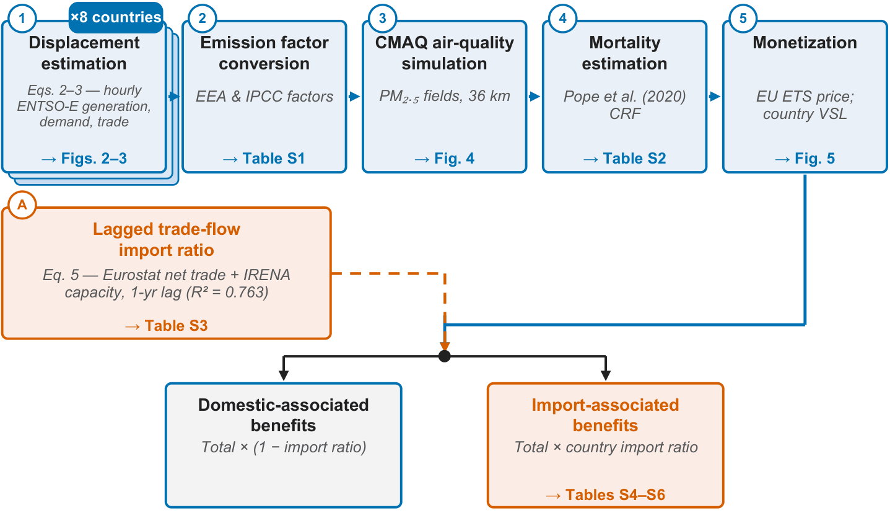

# Health and climate benefits of solar photovoltaics in Europe and the role of imports

*Nexus*

paper

Solar generation avoided 47 million tonnes of carbon dioxide and more than 13,000 premature deaths, yielding \$116.2 billion in monetized benefits (about \$150 per installed kilowatt per year) across eight European countries from 2015 to 2021. An estimated 40% of these benefits is associated with imported solar panels on a benefit-weighted basis.

Authors

Kaifang Luo

Yun Li

Guochao Chen

Minghao Qiu

Froylan E. Sifuentes

Hongliang Zhang

Gang He

Published

October 29, 2026

> **NOTE:**
>
> Health and climate benefits of solar photovoltaics in Europe and the role of imports  
> Kaifang Luo, Yun Li, Guochao Chen, Minghao Qiu, Froylan E. Sifuentes, Hongliang Zhang\*, **Gang He**\*  
> *One Earth* (2026)  
> DOI: [10.1016/j.ynexs.2026.100177](https://doi.org/10.1016/j.ynexs.2026.100177)



nalytical framework

## Abstract

Solar photovoltaics deployment has grown rapidly in Europe, yet its health and climate benefits remain underreported. We quantify these benefits across eight European countries from 2015 to 2021 by combining statistical modeling of hourly electricity generation, air quality simulation, health impact assessment, and trade data analysis. Solar generation avoided 47 million tonnes of carbon dioxide and more than 13,000 premature deaths, yielding \$116.2 billion in monetized benefits (about \$150 per installed kilowatt per year), 99% of which came from improved air quality. Cross-border electricity trade extended these benefits to neighboring countries. Applying trade-flow-derived import ratios, which range from 21% to 92% across countries, an estimated 40% of these benefits is associated with imported solar panels on a benefit-weighted basis; this estimate does not trace specific modules. Our findings provide much-needed evidence to inform policy debates on accelerating clean energy deployment and shaping the future of global clean energy supply chains.

## Links

Published [paper](https://www.cell.com/nexus/fulltext/S2950-1601(26)00060-4)

Open-access [pdf](https://www.cell.com/nexus/pdf/S2950-1601(26)00060-4.pdf)

Zenodo [data and resources](https://zenodo.org/records/23480950)

## Citation

BibTeX citation:

``` quarto-appendix-bibtex
@article{luo2026,
  author = {Luo, Kaifang and Li, Yun and Chen, Guochao and Qiu, Minghao
    and E. Sifuentes, Froylan and Zhang, Hongliang and He, Gang},
  title = {Health and Climate Benefits of Solar Photovoltaics in
    {Europe} and the Role of Imports},
  journal = {Nexus},
  pages = {100177},
  date = {2026-10-29},
  url = {https://doi.org/10.1016/j.ynexs.2026.100177},
  doi = {10.1016/j.ynexs.2026.100177},
  langid = {en}
}
```

For attribution, please cite this work as:

Luo, Kaifang, Yun Li, Guochao Chen, et al. 2026. “Health and Climate Benefits of Solar Photovoltaics in Europe and the Role of Imports.” *Nexus*, October 29, 100177. <https://doi.org/10.1016/j.ynexs.2026.100177>.
